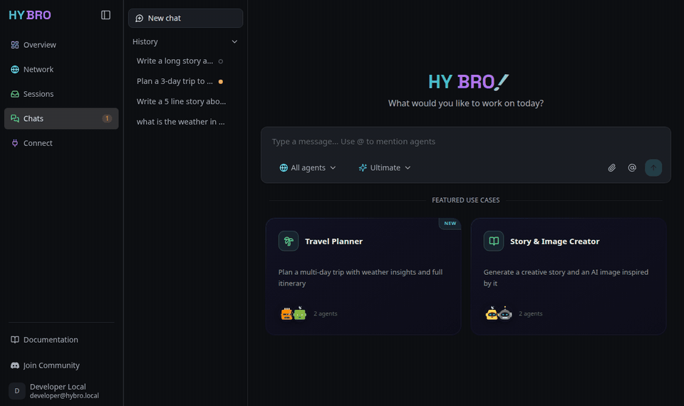
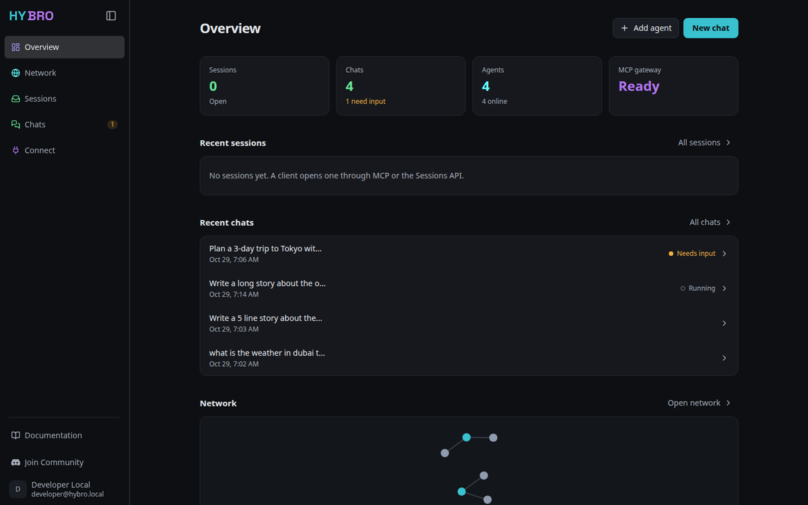
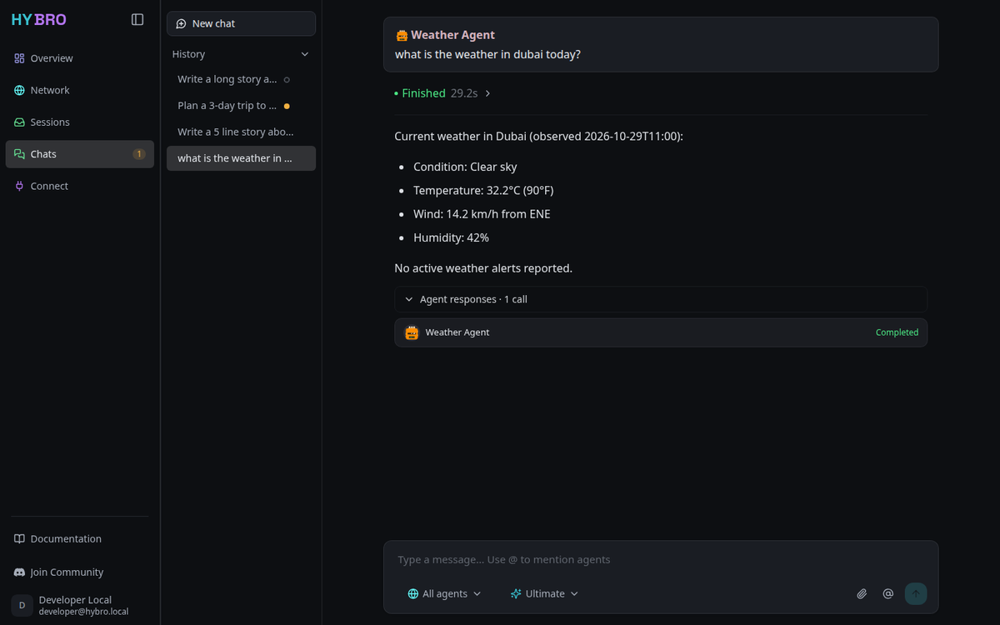
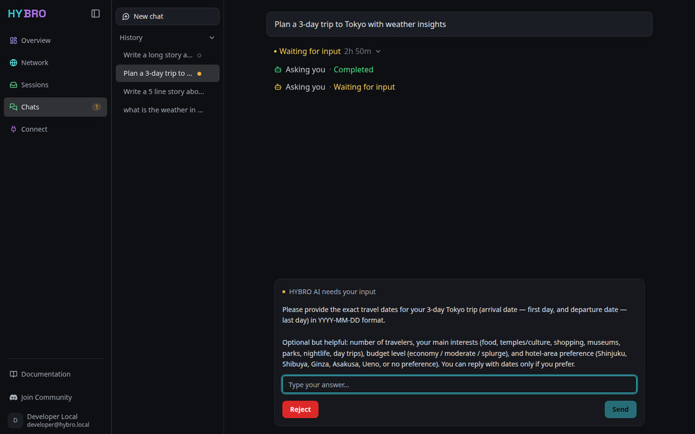
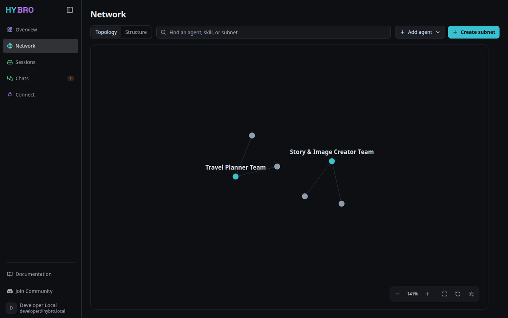
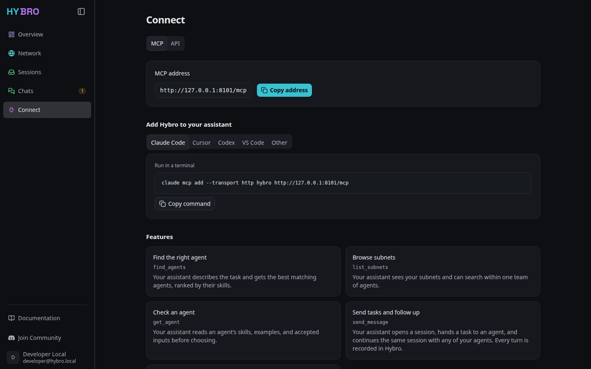

<div align="center">
  <a href="https://hybro.ai">
    <picture align="center">
      <source media="(prefers-color-scheme: dark)" srcset="assets/logo-dark.svg">
      <source media="(prefers-color-scheme: light)" srcset="assets/logo-light.svg">
      
    </picture>
  </a>

  <p>
    The open-source agent interoperability platform.<br />
  </p>

  <p>
    <a href="https://opensource.org/licenses/Apache-2.0"></a>
    <a href="https://x.com/HybroAI"></a>
    <a href="https://www.linkedin.com/company/hybroai"></a>
    <a href="https://discord.gg/2S5pCKzUmJ"></a>
  </p>
</div>

<p align="center">
 ⭐ <em>Star this repo to support the growing Hybro open-source community!</em>
</p>

Hybro AI is an open-source, hybrid multi-agent platform built for seamless agent interoperability. It serves as the core orchestration engine powering the Hybro Agent Network—enabling local and remote AI agents to communicate, collaborate, and execute complex workflows.

<p align="center">
  
</p>

## Contents

- [Overview](#overview)
- [Getting Started](#getting-started)
  1. [Prerequisites](#1-prerequisites)
  2. [Install and start](#2-install-and-start)
  3. [Open the app](#3-open-the-app)
  4. [Take a tour](#4-take-a-tour)
  5. [Connect an MCP client](#5-connect-an-mcp-client)
- [Running](#running)
- [Configuration](#configuration)
- [Development and released stacks](#development-and-released-stacks)
- [Architecture](#architecture)
- [Contributing](#contributing)

## Overview
Hybro AI allows developers and teams to deploy, coordinate, and inspect clusters of autonomous AI agents. Powered by an async FastAPI backend and an interactive Next.js dashboard, Hybro provides real-time agent visualization, execution room management, and protocol-agnostic message routing via the Agent2Agent (A2A) standard.

### Key Features
- **Hybrid Agent Execution**: Seamlessly connect and orchestrate local on-device agents and remote cloud-hosted services.
- **Native Agent Interoperability**: Built around the open Agent2Agent (A2A) protocol for standardized inter-agent communication.
- **Multi-Agent Execution Rooms**: Group specialized agents in dedicated execution rooms to solve multi-step tasks collaboratively.
- **Real-Time Streaming & Inspection**: Live SSE message streaming, multi-agent turn timelines, and an interactive A2A Agent Inspector for testing agent capabilities.
- **CLI-Managed Configuration**: Configure models and authentication once, then start backend, frontend and Agents without maintaining environment files.

## Getting Started

### 1. Prerequisites

| You need | When |
|---|---|
| Docker with Compose v2.24+ (`docker compose`; the v1 `docker-compose` binary is not supported) | Always |
| An API key for OpenAI, DeepSeek, or Anthropic, or a ChatGPT account for OAuth | Always |
| Node.js 18+ | To install the CLI from npm (not needed for release-asset installs) |
| [uv](https://docs.astral.sh/uv/) | To run `hybro setup` from a source checkout |
| Node.js 20.19+ | Only to run the frontend outside of Docker |
| Python 3.12+ and MongoDB 4.2+ | Only to run the backend outside of Docker (Docker Compose uses MongoDB 7.0) |
| Redis 7 | Optional for a single backend process outside of Docker; required for multi-worker deployments |

### 2. Install and start

Choose one way to run Hybro. Both use the same `hybro setup` step and the same
configuration in `~/.hybro/`.

| | Released CLI | Source checkout |
|---|---|---|
| Use it to | Try or use Hybro | Change Hybro, or use settings the published images cannot carry |
| Images | Pulled for the CLI's version | Built from your working tree |
| App | http://localhost:3000 | http://localhost:3100 |
| API | http://localhost:8000 | http://localhost:8100 |
| MCP | http://127.0.0.1:8001/mcp | http://127.0.0.1:8101/mcp |

**Option A: Released CLI**

```bash
npm install -g @hybroai/cli
hybro setup          # provider, authentication, models -> ~/.hybro/{config,auth}.json
hybro start          # pulls the images published for this CLI's version
```

Alternatively, run the CLI without installing it by unpacking a release asset
(`hybro-<version>-<platform>.tar.gz` from the GitHub Release) and executing
`hybro/hybro`.

**Option B: Source checkout**

```bash
git clone https://github.com/hybroai/hybro.git
cd hybro
./scripts/hybro setup
./scripts/hybro start --build
```

The first build takes several minutes. In a checkout, use `./scripts/hybro`
wherever this README shows `hybro`. See
[Development and released stacks](#development-and-released-stacks) for how the
two installs differ.

**What `setup` asks for**

`hybro setup` supports an OpenAI API key or ChatGPT OAuth, a DeepSeek API key,
or an Anthropic API key. It verifies the text model with one Provider request
and saves nothing if verification fails. Image generation requires an eligible
image model, offered only with an OpenAI API key; ChatGPT OAuth alone does not
enable it.

Running `hybro` with no arguments opens the same settings/services interface in
a terminal. After **Verify and save** there, **Start services** recreates the
containers so the saved settings take effect; from a checkout it also rebuilds
images. `hybro --version` prints the CLI and stack version.

Upgrading from an older install that used `.env` or `config.yaml`? Run the
one-time migration in [Existing installations](#existing-installations) before
removing old environment files.

### 3. Open the app

Open the app URL from the table above. The **Overview** page shows your chats,
the four bundled agents, and whether the MCP gateway is ready.

<p align="center">
  
</p>

If the page does not load, check the services with `hybro status` and
`hybro logs backend`.

### 4. Take a tour

**Start a chat.** Open **Chats** and select **New chat**. Type `@` to mention an
agent, or keep **All agents** so Hybro can choose from every available agent.
Pick **Ultimate** for big tasks that need planning, or **Fast** for quick and
simple questions. Replies stream in live, and **Agent responses** shows which
agents were called.

<p align="center">
  
</p>

**Answer an agent.** When an agent needs more information or approval, the chat
shows the question and waits for you to **Send** an answer or **Reject** it.
The **Chats** badge counts chats that need input.

<p align="center">
  
</p>

**Explore the network.** **Network** shows every registered agent and the
subnets (teams) that group them. Use **Add agent** to register your own A2A
agent, or **Create subnet** to group agents.

<p align="center">
  
</p>

The bundled agents are **Weather Agent**, **Story Agent**,
**Travel Planner Agent**, and **Image Generator Agent**. The **Travel Planner**
and **Story & Image Creator** cards
on the Chats page start a ready-made multi-agent chat.

### 5. Connect an MCP client

`hybro start` and the TUI's **Start services** include MCP by default. In the
app, open **Connect** (`/connect/mcp`) to copy the URL or a setup snippet for
Claude Code, Cursor, Codex, VS Code, or another assistant. The Overview
**MCP gateway** tile shows whether MCP is reachable. Add the server manually to
your client; Hybro does not automatically discover or register MCP clients.

<p align="center">
  
  <br />
  <em>Captured from a source checkout, so it shows the dev MCP URL on port 8101.
  A released install shows port 8001.</em>
</p>

```json
{
  "mcpServers": {
    "hybro": { "type": "http", "url": "http://127.0.0.1:8001/mcp" }
  }
}
```

That is the released install's URL. A source checkout runs the dev instance,
whose MCP URL is `http://127.0.0.1:8101/mcp`.

The **Streamable HTTP** URL is for clients on the machine running Hybro. If you
open the app remotely, loopback in your client still refers to that client's
machine, not the Hybro host. MCP has no authentication or user isolation and
supports only a trusted local mock-auth backend, not Clerk. Do not expose it
publicly.

Use **Services > MCP connection** in the TUI for status, URL, transport, start,
stop, logs, and refresh, or run:

```bash
hybro mcp status
hybro mcp start    # requires setup and a running backend; starts only MCP
hybro mcp logs
hybro mcp stop
```

Exiting the TUI leaves services running. Stopping MCP is not a persistent opt-out:
the next global start includes it again. The app checks MCP status only from the
Overview **MCP gateway** tile, when Overview loads; it does not poll in the
background, and it cannot start/stop services or relay tool calls.
See [MCP tools, health, and native startup](backend/README.md#local-mcp-access).

## Running

`./scripts/hybro` is the day-2 lifecycle CLI. Common commands:

```bash
./scripts/hybro start                    # up -d, no rebuild (fast daily loop)
./scripts/hybro start --build            # rebuild images (after code/deps change)
./scripts/hybro start --recreate         # recreate containers (runtime configuration changes)
./scripts/hybro start --build --recreate # rebuild and recreate (after code/deps change)
./scripts/hybro logs backend             # stream one service (or all if no arg)
./scripts/hybro status                   # docker compose ps --all
./scripts/hybro stop                     # stop but keep containers
./scripts/hybro down                     # remove containers + default network
```

Only a source checkout can rebuild; a released install changes versions with
`hybro upgrade`. Configuration never needs a rebuild, except `api_prefix`.

Run `./scripts/hybro --help` for the full subcommand reference. Start through the
CLI so Compose receives validated scoped projections, not ambient dotenv values.

## Configuration

### Configuration contract

Backend, frontend and bundled-agent user settings belong to one local JSON
configuration, not repository environment files:

```text
~/.hybro/
├── config.json   # User settings; edit through the CLI or directly
└── auth.json     # Credentials; managed through the CLI
```

`HYBRO_HOME` is the sole directory override and must be an absolute path.
Defaults, types and validation remain in a thin code loader; JSON only needs
user overrides. `backend/common/config/loader.py` replaces the old `settings.py`
environment-loading path. Startup validates syntax, known fields, types, ranges and
required combinations. Missing model setup must direct the user to `hybro setup`;
invalid configuration must not silently select a legacy Provider.

CLI edits use the same validation before saving. Manual JSON edits are validated
at the next startup. Settings are a startup snapshot: restart services after
changes with `hybro start --recreate`. Only `api_prefix` needs a rebuild, because
the frontend image compiles its server-side API rewrite from it; the browser
reads every other public setting from the running container.

`.env`, `.env.example` and `frontend/.env.local` are not required by this contract.
The CLI supplies only scoped values to containers and frontend builds; transport
environment variables do not become another user configuration source. Secrets
must never enter the browser bundle or be forwarded wholesale to Agents.

### Edit configuration

```bash
./scripts/hybro config show
./scripts/hybro config check
./scripts/hybro config set backend.log_level '"DEBUG"'
./scripts/hybro config set frontend.max_message_length 12000
./scripts/hybro start --recreate
```

Use `config secret <name>` for hidden service-credential input and `setup` for
Provider/model changes. Startup generates missing internal tokens in `auth.json`
without rotating existing values. Backend overrides live under `backend`, public
frontend overrides under `frontend`, and image output size is `image_size`.

### Model access for Agents

The already-implemented Agent proxy shares backend's setup-selected gateway.
Agents retain SDKs, tools, HITL and A2A execution. Agents receive a scoped
`HYBRO_AGENT_CONFIG` projection containing the backend proxy URL, a separate
inference token and image size. They pass these values explicitly to their SDKs.
The token cannot authenticate as a user or registrar; it is required even under
mock auth. Agents never receive Provider credentials or the setup directory.
See [gateway architecture](backend/docs/System-Architecture.md#llm_gateway) for
the supported proxy subset and limits.

### Backend configuration fields

Waits for the owner or for a remote Agent:

| Field | Default | Meaning |
|---|---|---|
| `backend.approval_deadline_hours` | `null` (no deadline) | Hours before an unanswered supervisor question expires and fails its Run. Must be greater than 0 when set. |
| `backend.orchestrator_call_wait_ceiling_hours` | `168` (seven days) | Hours an acknowledged remote Agent task is polled with `tasks/get` before the call expires. Must be greater than 0. |
| `backend.a2a_push_callback_base_url` | `""` (push disabled) | Base URL that remote Agents can reach. Must be `https`; plain `http` is accepted only for loopback (`localhost`, `127.0.0.0/8`, `::1`), `host.docker.internal`, or a private RFC 1918 address, because the per-call push token travels in a request header. When set, Hybro registers a per-call push notification URL with Agents whose card advertises push support, so late results arrive without waiting for the next poll. Polling stays the fallback. |

```bash
./scripts/hybro config set backend.approval_deadline_hours 48
./scripts/hybro config set backend.orchestrator_call_wait_ceiling_hours 72.5
./scripts/hybro config set backend.a2a_push_callback_base_url '"https://hybro.example.com"'
```

A Run waiting for an answer or a remote Agent does not count that time against
its profile deadline, so it can wait as long as these limits allow. While it
waits it keeps the room's single active-Run slot.

Passthrough Runs (session sends, no orchestrator model turns):

| Field | Default | Meaning |
|---|---|---|
| `backend.orchestrator_passthrough_deadline_seconds` | `300` | Active seconds a passthrough Run may take; time spent waiting for the owner or a remote Agent does not count. Must be greater than 0. |
| `backend.orchestrator_passthrough_max_transport_retries_per_call` | `2` | Transport retries for the single Agent call. Must be greater than 0. |

Sessions:

| Field | Default | Meaning |
|---|---|---|
| `backend.session_run_start_grace_seconds` | `10` | Seconds after a send without any lifecycle event for the request before the session reports `failed` with `run_not_started`. Must be greater than 0. |

### Existing installations

If you previously ran `hybro setup` and have a `~/.hybro/config.yaml`, convert
it once (optionally importing known deployment values from the old root `.env`):

```bash
./scripts/hybro config migrate --from-env .env
./scripts/hybro config check
./scripts/hybro start --recreate
```

Omit `--from-env` if no deployment values need importing. Migration preserves
Provider credentials and imports known deployment settings and service secrets;
it refuses to overwrite an existing `config.json`. Original environment files,
`.env.example` and `config.yaml` are not deleted.

Installations that only used the old root `.env` (no YAML setup) must instead
re-run the interactive setup, then start:

```bash
./scripts/hybro setup
./scripts/hybro start --recreate
```

After either path, normal setup/start uses JSON only, even if the old files
remain. `migrate` warns when it skips legacy route/model fields it cannot map.

## Development and released stacks

The CLI runs one of two Compose files. Each pins its own project name, so
containers keep their identity across install locations and the two stacks never
share containers or volumes:

| | Source checkout | Released install |
|---|---|---|
| Instance | `dev` | `release` |
| Compose project | `hybro-dev` | `hybro` |
| Default host ports (app, API, MCP) | 3100, 8100, 8101 | 3000, 8000, 8001 |
| Stack file | `docker-compose.yml` | `docker-compose.release.yml` |
| Services come from | local `build:` | published `image:` |
| Version | the working tree | the CLI's own `VERSION` |
| Rebuild | `start --build` | not possible; install a newer CLI |

Both instances read the same `~/.hybro/config.json` and `auth.json`, so the
Provider and models are set once and either TUI can change them. Only host ports
differ per instance: every release default (Mongo 27017, Redis 6379, and each
default agent included) moves up by 100 for dev, and any of them can be set under
`instances.<dev|release>.ports` with `hybro config set` or the TUI **Ports** page.
No port may repeat within or across instances, because both stacks can run at
once. A released CLI older than this change rejects a `config.json` that contains
`instances`, so upgrade the release before setting overrides. Run Compose through
the CLI: a bare `docker compose` call in a checkout targets `hybro-dev` with the
release default ports.

### Moving an older checkout

A checkout that ran before this split used project `hybro`. Its containers keep
holding 3000/8000/8001 and its data stays in the `hybro_*` volumes, because
`./scripts/hybro stop` now stops only `hybro-dev`. Move it once, before the first
dev start:

```bash
docker compose -p hybro down
```

```bash
for n in mongo_data redis_data room_files; do
  docker volume create --label com.docker.compose.project=hybro-dev \
    --label com.docker.compose.volume=$n hybro-dev_$n
  docker run --rm -v hybro_$n:/from:ro -v hybro-dev_$n:/to alpine cp -a /from/. /to/
done
```

```bash
./scripts/hybro start --build --recreate
```

Once the dev stack shows your data, the `hybro_*` volumes can be removed. Skip
this when a released install already uses project `hybro`: those are its own
containers and volumes.

### Upgrading

Because a released install has no sources, `--build` is refused with an explicit
message. Upgrading is how you change versions:

```bash
hybro upgrade --check       # report; exits non-zero when a newer release exists
hybro upgrade               # install it
hybro start --recreate      # move the containers onto its images
```

The container images are pinned to the CLI version, so upgrading the CLI is what
moves the stack. `hybro upgrade` replaces an npm install in place; an install
from a release archive prints the download, checksum, and unpack commands
instead, because hybro does not overwrite its own directory. A source checkout is
updated with `git pull` and `hybro start --build`.

Everything else, including frontend settings, applies at runtime:

```bash
hybro config set frontend.max_message_length 12000
hybro start --recreate      # no rebuild needed
```

The one exception is `backend.api_prefix`: the published frontend image compiles
its server-side API rewrite from the prefix at build time, so changing it needs
the checkout channel. The browser reads the rest of the projection from a
per-request route (`/hybro-runtime-config`) that
`packaging/frontend/public-config.json` supplies at build time only for that
routing.

How the released Compose file is generated, and how releases are published, is
covered in [RELEASING.md](RELEASING.md).

## Architecture
This repository is the source of truth for the product. Its frontend and backend
are the in-repository `frontend/` and `backend/` directories used by Docker
Compose and CI.

The repository is split into these primary components:
- `backend/`: A FastAPI orchestration engine using MongoDB for persistence and optional Redis services for cross-process coordination.
- `frontend/`: A Next.js 16 (Turbopack) application for chat, local agent discovery, agent management, and inspection.
- `default_agents/`: A collection of ready-to-use A2A agents, each running as its own container, plus a one-shot `registrar` that registers them with the backend on startup.
- `MCP/`: A standalone adapter exposing two backend agent-network tools over Streamable HTTP, built with its own Dockerfile and published as the version-pinned `hybro-mcp` image.

For module boundaries, data flow, and streaming, see
[backend/docs/System-Architecture.md](backend/docs/System-Architecture.md) and
[frontend/docs/System-Architecture.md](frontend/docs/System-Architecture.md).

## Contributing
We welcome contributions from the community! Whether you are fixing a bug, adding a feature, or improving documentation, please feel free to open a pull request.

See [CONTRIBUTING.md](CONTRIBUTING.md) for local development setup, tests, and
commit conventions. Maintainers publishing a release should follow
[RELEASING.md](RELEASING.md).

1. Fork the repository
2. Create a feature branch (`git checkout -b feature/amazing-feature`)
3. Commit your changes (`git commit -m 'feat: add amazing feature'`)
4. Push to the branch (`git push origin feature/amazing-feature`)
5. Open a Pull Request

## License
Apache License 2.0
